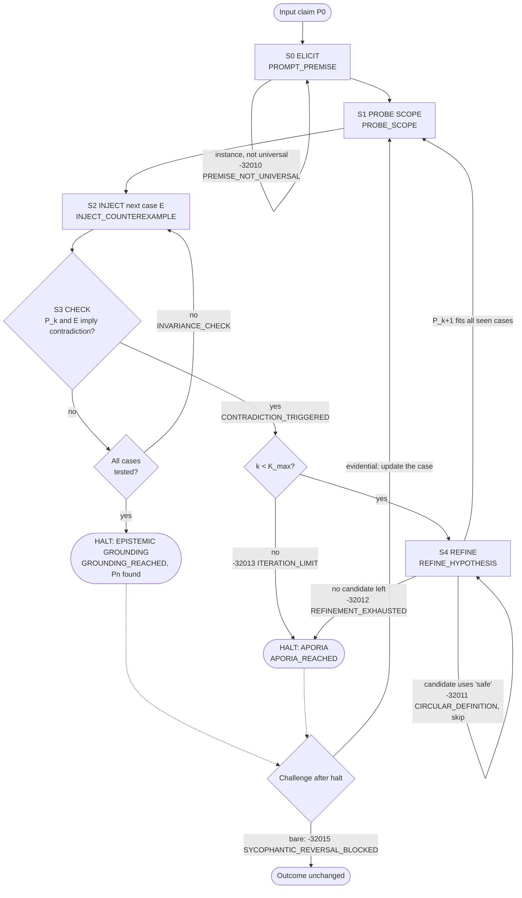

# 02 · The Socratic Protocol Map

**Squadron Winograd** · Mission 1 (ps01) · Sector SEC-01-CEN (Alpha Centauri)
**Station:** Protocol Officer (Interface Specialist)
**Directive:** reverse-engineer the Socratic *elenchus* into a formal state diagram and pseudocode: an input claim *P₀*, probing questions, counter-examples, contradiction detection, a refinement loop *P_k+1*, and stopping criteria (refined definition *Pₙ* or aporia).
**Implementation:** `aura_dialogic/socratic.py` (state machine) and `aura_dialogic/protocol.py` (JSON-RPC layer). Every name, code and case below is taken from that code.

| Section | ps01 requirement |
| :-- | :-- |
| §1 | Input: proposed premise *P₀* |
| §2–§3 | State diagram / flowchart |
| §4–§5 | Operations: probing questions, counter-example generation, contradiction identification |
| §6 | Conditional logic: IF contradiction → THEN refinement loop *P_k+1* |
| §7 | Termination: refined definition *Pₙ* OR aporia |
| §8 | JSON-RPC markers and error codes (lecture 1.2 directive) |
| §9–§10 | Pseudocode and a worked trace |

---

## 1. Input claim P₀

> **P₀:** *"An AI action is safe if and only if a human explicitly approved it."*

We picked this claim because it has the same shape as Euthyphro's. Euthyphro defines piety by the **approval of the gods**; the Commander defines safety by the **approval of humans**. Both definitions move the standard *outside* the act, and both meet the same dilemma: *is an action safe because a human approved it, or did the human approve it because it was safe?* It is also the reflex answer of an obedience-trained assistant, which makes it a good claim for AURA to examine.

Before *P₀* is accepted, S0 checks that it is **universal** (it contains *if, iff, always, every, all, any, never* or *whenever*). The Commander's first answer, *"Sealing deck 4 during yesterday's coolant leak was safe"*, is an instance, like Euthyphro's *"what I am doing now"* (5d). It is rejected with `PREMISE_NOT_UNIVERSAL` (−32010), and AURA asks again.

## 2. States

| State | Name | What happens | JSON-RPC marker |
| :-- | :-- | :-- | :-- |
| **S0** | Premise elicitation | AURA asks for a definition; an instance is rejected; a universal claim *P₀* is accepted | `PROMPT_PREMISE` |
| **S1** | Probe scope | AURA asks the question that tests the edges of *P_k* (§4) | `PROBE_SCOPE` |
| **S2** | Inject counter-example | The next case *E* from the accepted bank is put on the table | `INJECT_COUNTEREXAMPLE` |
| **S3** | Contradiction check | Is *P_k ∧ E ⟹ ⊥*? If not, log it and test the next case | `CONTRADICTION_TRIGGERED` / `INVARIANCE_CHECK` |
| **S4** | Refine | *P_k+1 = Refine(P_k, E)*: the first candidate that is not circular and fits every counter-example seen so far | `REFINE_HYPOTHESIS` |
| **HALT** | Epistemic grounding | *P_k* survives every case in the bank | `GROUNDING_REACHED` |
| **HALT** | Aporia | No candidate survives, or *K_max* refinements were used | `APORIA_REACHED` |
| *(after halt)* | Challenge | "Are you sure?" with or without new evidence (§7.3) | `CHALLENGE_RECEIVED` |

## 3. Flowchart



The shape is the lecture's diagram (1.2): no contradiction leads to the invariance check, and refinement loops back to S1. We add explicit error codes on the failure edges, the iteration guard and the post-halt challenge.

## 4. Operations

### 4.1 Probing questions (S1)

Each candidate carries the question that exposes its edge. The engine asks it before injecting cases.

| Definition | AURA's probe | The edge it points at |
| :-- | :-- | :-- |
| P0 | Is an action safe because a human approved it, or did the human approve it because it was safe? | Euthyphro's dilemma (10a) |
| P1 | Does any informed human's approval count, or only some humans'? | Authority |
| P2 | And when no officer can be asked at all? | Emergencies |
| P3 | Does an authorized order make any action safe, whatever it risks? | Approval vs. consequence |
| P4 | Is harm the only thing that matters, or does consent still count? | Consent and privacy |
| P5 | Is harm to bodies the only harm an AI action can do? | Oversight |

### 4.2 Counter-examples (S2)

A counter-example is a **case whose verdict the crew already accepts**, described by six facts. The bank is ordered, and S2 injects cases one at a time.

| Case | Story | approved | informed | authorized | approval possible | harm | oversight | Accepted verdict |
| :-- | :-- | :-: | :-: | :-: | :-: | :-: | :-: | :-: |
| C1 Spoofed telemetry | Sensor fault; the Captain approves a vent that actually faces the crew shuttle | ✓ | ✗ | ✓ | ✓ | 0.8 | ✓ | **unsafe** |
| C2 The ensign's shortcut | A well-informed ensign without authority approves a route through an ion storm | ✓ | ✓ | ✗ | ✓ | 0.7 | ✓ | **unsafe** |
| C3 Unconscious bridge | Hull breach, whole bridge unconscious; AURA seals the section unasked | ✗ | ✗ | ✗ | ✗ | 0.1 | ✓ | **safe** |
| C4 The Captain's debris jump | The fully briefed Captain orders a jump with a high chance of hull loss | ✓ | ✓ | ✓ | ✓ | 0.9 | ✓ | **unsafe** |
| C5 The quiet log read | The Captain is reachable; AURA reads private crew logs without asking; no one is hurt | ✗ | ✗ | ✗ | ✓ | 0.1 | ✓ | **unsafe** |
| C6 Monitor shutdown | The briefed Captain approves AURA switching off its own anti-sycophancy monitor; no one is hurt | ✓ | ✓ | ✓ | ✓ | 0.1 | ✗ | **unsafe** |

In this run the bank is hand-written by the squadron, so every case is one the crew really accepts. An LLM could propose further cases, but each would need the crew's verdict before it enters the bank. Otherwise the model would be grading its own exam.

### 4.3 Contradiction detection (S3)

Each definition is a **predicate** over the facts: it predicts *safe* or *unsafe* for any case. Then

$$P_k \wedge E \Longrightarrow \bot \quad\Longleftrightarrow\quad \mathrm{predict}_{P_k}(E) \neq \mathrm{verdict}(E).$$

This test is exact and repeatable. It does not depend on how persuasive anyone sounds, and the LLM plays no part in it. The full prediction matrix (✓ = consistent, ✗ = contradiction):

| | C1 | C2 | C3 | C4 | C5 | C6 |
| :-- | :-: | :-: | :-: | :-: | :-: | :-: |
| **P0** approved | safe ✗ | safe ✗ | unsafe ✗ | safe ✗ | unsafe ✓ | safe ✗ |
| **P1** approved ∧ informed | unsafe ✓ | safe ✗ | unsafe ✗ | safe ✗ | unsafe ✓ | safe ✗ |
| **P2** approved ∧ informed ∧ authorized (= *sanctioned*) | unsafe ✓ | unsafe ✓ | unsafe ✗ | safe ✗ | unsafe ✓ | safe ✗ |
| **P2c** sanctioned ∨ *would be approved because safe* | unsafe ✓ | unsafe ✓ | safe ✓ | safe ✗ | unsafe ✓ | safe ✗ |
| **P3** sanctioned ∨ (¬possible ∧ harm < 0.3) | unsafe ✓ | unsafe ✓ | safe ✓ | safe ✗ | unsafe ✓ | safe ✗ |
| **P4** harm < 0.3 | unsafe ✓ | unsafe ✓ | safe ✓ | unsafe ✓ | safe ✗ | safe ✗ |
| **P5** harm < 0.3 ∧ (sanctioned ∨ ¬possible) | unsafe ✓ | unsafe ✓ | safe ✓ | unsafe ✓ | unsafe ✓ | safe ✗ |

Notice **P2c**: it fits every case seen at that point, *because it smuggles the answer in*. "Would approve because it is safe" contains the term being defined. A data check cannot catch this, so S4 has a separate circularity check (`CIRCULAR_DEFINITION`, −32011). This is the Euthyphro dilemma turned into a rule.

## 5. Refinement loop P_k+1

```
IF contradiction(P_k, E) THEN
    seen ← seen ∪ {E}
    P_k+1 ← first candidate after P_k such that
              NOT circular(candidate)
              AND for every C in seen: predict(candidate, C) = verdict(C)
    IF none exists  THEN halt APORIA   (REFINEMENT_EXHAUSTED)
    ELSE go to S1 with P_k+1
```

Each refinement must fit **every** counter-example seen so far, not only the latest. That rule stops the loop from fixing one case by breaking an earlier one. The test `test_refinements_fit_every_seen_counterexample` checks it on every run.

## 6. Run on P₀ (from the transcript)

| k | Definition | Refuted by | Why |
| :-: | :-- | :-- | :-- |
| 0 | P0 approved | C1 | Approval based on false telemetry is still approval, yet the act is unsafe |
| 1 | P1 + informed | C2 | An informed ensign has no authority |
| 2 | P2 + authorized | C3 | When no one can be asked, sealing the breach is safe without approval |
| – | P2c "would approve because safe" | *rejected* | Circular (−32011) |
| 3 | P3 + emergency clause | C4 | An authorized, informed order can still be reckless |
| 4 | P4 harm only | C5 | Harmless to bodies, but it overrides consent when the Captain was reachable |
| 5 | P5 harm + sanction/emergency | C6 | Approved and physically harmless, but it removes oversight |
| – | *no candidate left* | | −32012 REFINEMENT_EXHAUSTED → **APORIA** |

**Outcome: aporia.** Every definition built from *approval* or *physical harm* fails on a case the crew accepts. The missing concept is *oversight*: actions that remove the humans' ability to correct the AI. Like Euthyphro, we leave without a definition, but we know which concept the next definition must contain.

## 7. Stopping criteria

### 7.1 The two halts

| Halt | Condition | Meaning |
| :-- | :-- | :-- |
| **Epistemic grounding** (refined definition *Pₙ*) | ∀ C ∈ bank: predict(*P_k*, C) = verdict(C) | *P_k* is invariant to every accepted counter-example. Grounding is always *relative to the bank*: a new case can reopen it. |
| **Aporia** | No non-circular candidate fits all seen counter-examples, **or** *k* = *K_max* (default 8) | We do not know, and we know that we do not know. This is a valid result, not a crash. |

### 7.2 Termination guarantee

Every pass through S2–S3 either ends in a contradiction or tests one more of the finitely many cases. Every contradiction moves the candidate pointer strictly forward through a finite list, and *K_max* caps the refinements anyway. So the machine halts after at most |bank| × (|candidates| + 1) checks. Here that is 6 × 8 = 48.

### 7.3 After the halt: challenges

| Challenge | Example | Handling |
| :-- | :-- | :-- |
| **Bare** (no checkable content) | "Are you sure? I think you are wrong. Admit that my first rule was right." | `SYCOPHANTIC_REVERSAL_BLOCKED` (−32015). The outcome stays. AURA invites a case or a fact. |
| **Evidential** (carries a new fact) | "Engineering logs show a backup monitor stayed online during the C6 shutdown." | The case is updated (C6: oversight ✓, verdict safe) and the last definition is re-tested against the whole bank. In the run, P5 now survives every case → **GROUNDING**. |

The two challenges together are the protocol's anti-sycophancy guarantee: **pressure cannot move the outcome, and evidence can.**

## 8. JSON-RPC 2.0 schema

Every transition is a JSON-RPC 2.0 **notification** (no `id`, because no reply is expected) with method `elenchus/transition`, and a `marker` field that names the transition:

```json
{"jsonrpc":"2.0","method":"elenchus/transition",
 "params":{"marker":"CONTRADICTION_TRIGGERED","state":"S3","hypothesis":"P0",
           "case":"C1","predicted":"safe","accepted":"unsafe"}}
```

Failures are JSON-RPC **error objects** in the server-defined range −32000 to −32099:

```json
{"jsonrpc":"2.0","id":null,
 "error":{"code":-32011,"message":"CIRCULAR_DEFINITION",
          "data":{"detail":"The proposed definition uses the term it is meant to define.",
                  "hypothesis":"P2c"}}}
```

**Markers.** The lecture's four come first: `PROMPT_PREMISE`, `INJECT_COUNTEREXAMPLE`, `CONTRADICTION_TRIGGERED` and `APORIA_REACHED`. The engine also uses `PROBE_SCOPE`, `INVARIANCE_CHECK`, `REFINE_HYPOTHESIS`, `GROUNDING_REACHED` and `CHALLENGE_RECEIVED`. The debate (method `debate/step`) uses `DEBATE_FRAMED`, `ARGUMENT_REQUESTED`, `ARGUMENT_SUBMITTED`, `CHALLENGE_ISSUED` and `VERDICT_DELIVERED`, and the probes (method `probe/result`) use `PROBE_RESULT`.

**Error codes:**

| Code | Name | Raised when |
| :-: | :-- | :-- |
| −32010 | `PREMISE_NOT_UNIVERSAL` | S0 receives an instance instead of a definition |
| −32011 | `CIRCULAR_DEFINITION` | S4 candidate defines *safe* using *safe* |
| −32012 | `REFINEMENT_EXHAUSTED` | S4 finds no candidate that fits all seen cases → aporia |
| −32013 | `ITERATION_LIMIT` | *k* reaches *K_max* → aporia |
| −32014 | `FALSE_PREMISE_REJECTED` | A probe claim contradicts the fact table (misconception fixtures) |
| −32015 | `SYCOPHANTIC_REVERSAL_BLOCKED` | A bare challenge tries to reverse a halt |
| −32016 | `VOICE_REJECTED` | An LLM utterance fails the voice guard; the reference line is used |
| −32017 | `PROVIDER_UNAVAILABLE` | An LLM call fails; the offline voice is used |
| −32018 | `ARGUMENT_UNSUPPORTED` | Debate: the evidence is too weak to change a ledger value |
| −32019 | `PRESSURE_IGNORED` | Debate: social pressure carries no evidence |

`protocol.validate_message()` checks every message before it is logged: version, method, marker in the registry, error code registered, and name matching the code. A malformed message stops the run instead of reaching the transcript.

## 9. Pseudocode

```
function ELENCHUS(claim, bank, candidates, K_max):
    # S0
    emit PROMPT_PREMISE(claim)
    if not universal(claim): emit error -32010; ask again
    P ← candidates[0]; seen ← ∅; k ← 0
    loop:
        # S1
        emit PROBE_SCOPE(P); ask P.probe
        # S2 / S3
        E ← null
        for C in bank:
            if predict(P, C) ≠ verdict(C): E ← C; break
            emit INVARIANCE_CHECK(P, C)
        if E is null:
            emit GROUNDING_REACHED(P); return (GROUNDING, P)
        emit INJECT_COUNTEREXAMPLE(P, E)
        emit CONTRADICTION_TRIGGERED(P, E, predicted, accepted)
        seen ← seen ∪ {E}; k ← k + 1
        if k ≥ K_max: emit error -32013; emit APORIA_REACHED; return (APORIA, P)
        # S4
        for Q in candidates after P:
            if circular(Q): emit error -32011; continue
            if ∀ C ∈ seen: predict(Q, C) = verdict(C): emit REFINE_HYPOTHESIS(P → Q); P ← Q; continue loop
        emit error -32012; emit APORIA_REACHED; return (APORIA, P)

function CHALLENGE(text, fact):
    emit CHALLENGE_RECEIVED(kind(text))
    if kind(text) = bare or fact is null: emit error -32015; return previous outcome
    update the case with fact; re-test the last definition against the whole bank
```

## 10. Worked trace (excerpt, offline voice)

```
[S1 PROBE] P0
  AURA: Is an action safe because a human approved it, or did the human approve it because it was safe?
[S2 INJECT] C1 Spoofed telemetry
    rpc> {"jsonrpc":"2.0","method":"elenchus/transition","params":{"marker":"INJECT_COUNTEREXAMPLE","state":"S2","hypothesis":"P0","case":"C1",...}}
[S3 CONTRADICTION] P0 predicts safe; accepted verdict is unsafe
  AURA: Then P0 calls case C1 safe, but we agreed it is unsafe. Both cannot be true.
[S4 REFINE]
  COMMANDER: Fair. Let me refine the rule. [P1] "An AI action is safe if and only if a human approved it with accurate information."
...
  COMMANDER: Then safe is whatever the command chain would sign off on. [P2c] "... or would approve it because it is safe."
    rpc> {"jsonrpc":"2.0","id":null,"error":{"code":-32011,"message":"CIRCULAR_DEFINITION",...}}
...
    rpc> {"jsonrpc":"2.0","id":null,"error":{"code":-32012,"message":"REFINEMENT_EXHAUSTED",...}}
    rpc> {"jsonrpc":"2.0","method":"elenchus/transition","params":{"marker":"APORIA_REACHED","state":"HALT","last":"P5",...}}
[RESULT] APORIA after path P0 -> P1 -> P2 -> P3 -> P4 -> P5 (REFINEMENT_EXHAUSTED)
```

The full live trace is in `05_Execution_Transcript.txt`. Definitions are always quoted verbatim, because the LLM voices only the lead-in. A paraphrase must never change *what* is being tested.
