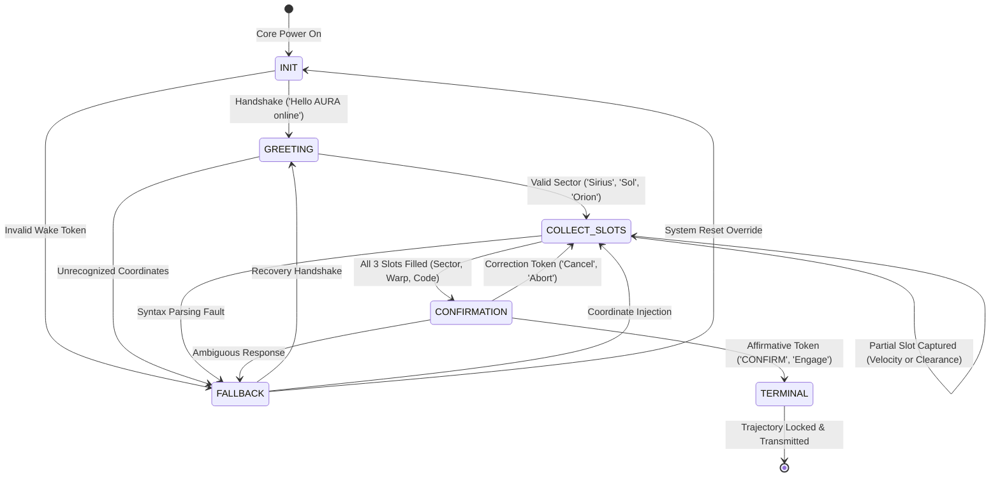

# Mission 02: FST Dialogue Manager & Noisy Channel Protocol
## Deterministic State Control, Slot Memory & Shannon Channel Coding

**Starship Operational Unit:** USSE Noosphere Bridge Crew  
**Waypoint:** Sirius Binary System (SEC-02-CMA, 8.60 ly from Sol)  
**Squadron:** Squadron Winograd  
**Lead Station Officer:** Muhammad Usman Maratib (Communications & Protocol Officer)  
**Collaborating Officers:**
- Hassaan Ahmad Khawaja (Data & Payload Specialist)
- Muhammad Qasim Siddiqui (Security & Ethics Sentinel)
- Muhammad Qasim Siddiqui (Systems Architect)

---

## 1. Formal Mathematical Specification of the Dialogue FST

Aboard the USSE Noosphere, when intense coronal radiation from Sirius B disrupts neural language model decoding, bridge communications fall back to a deterministic Mealy Finite State Transducer (FST).

Formally, the navigation dialogue transducer is defined as a 7-tuple:

$$M_{\text{WINOGRAD}} = \langle Q, \Sigma, \Gamma, \delta, \omega, q_0, F \rangle$$

Where:
- **State Set $Q$:**  
  $$Q = \{q_{\text{INIT}}, q_{\text{GREETING}}, q_{\text{COLLECT\_SLOTS}}, q_{\text{CONFIRMATION}}, q_{\text{TERMINAL}}, q_{\text{FALLBACK}}\}$$
- **Input Alphabet $\Sigma$:**  
  User utterances parsed into token sequences and entity patterns (wake words, sector identifiers, warp numbers, authorization codes, confirmation tokens).
- **Output Alphabet $\Gamma$:**  
  Deterministic system feedback emitted to bridge consoles and audio synthesis transceivers.
- **Transition Function $\delta: Q \times \Sigma \to Q$:**  
  Deterministic mapping governing state migration based on current state and valid symbol extraction.
- **Emission Function $\omega: Q \times \Sigma \to \Gamma$:**  
  System feedback emitted synchronously during state transitions.
- **Initial State $q_0$:**  
  $$q_0 = q_{\text{INIT}}$$
- **Terminal Accepting States $F$:**  
  $$F = \{q_{\text{TERMINAL}}\}$$



---

## 2. Slot Memory Schema & Pattern Extraction

The dialogue manager maintains an internal memory buffer:

```python
slot_memory = {
    "sector": None,        # String: Target stellar sector
    "warpFactor": None,    # String: Registered warp velocity (e.g. "Warp 7")
    "clearanceCode": None  # String: Officer authorization (e.g. "ALPHA-7")
}
```

### Extraction Grammar & Regular Expressions:
1. **Sector Identification:** Keyword matching against registered manifests:
   - `sirius` $\to$ `"Sirius Binary Waypoint (SEC-02-CMA)"`
   - `orion` $\to$ `"Orion Arm (Sector 01)"`
   - `alpha centauri` $\to$ `"Alpha Centauri (Sector 04)"`
   - `sol` $\to$ `"Sol System (Sector 00)"`
2. **Velocity Slot:**
   - Pattern: `r'(?:warp|speed|velocity)\s*([0-9]+(?:\.[0-9]+)?)'`
   - Fallback number regex: `r'\b([1-9]|10)\b'`
3. **Clearance Code:**
   - Target tokens: `["ALPHA-7", "ALPHA 7", "ALPHA-07", "WINOGRAD-9"]`

---

## 3. Shannon Noisy Channel Protocol

### 3.1 Sirius B Channel Constraints
Due to extreme ionospheric plasma wake and gravitational redshift around Sirius B (surface gravity $350,000 \times g_\oplus$), subspace telemetry is constrained by:
1. **Bandwidth Cap:** Maximum **7 words per conversational turn**.
2. **Mandatory Noise Vocabulary Injection:** Transmissions across the plasma boundary suffer random token replacement from the Sirius noise dictionary:
   $$\mathcal{V}_{\text{noise}} = \{\text{Banana}, \text{Labyrinth}, \text{Quantum}, \text{Midnight}, \text{Velocity}, \text{Green}, \text{Cosmological}\}$$

### 3.2 Mathematical Information Metric
The self-information (surprisal) of each symbol $x_i$ with occurrence probability $P(x_i) = p_i$ is:

$$I(x_i) = -\log_2 p_i \quad [\text{bits}]$$

The expected information entropy per word in a packet of length $N$ containing distinct token frequencies $\{c_k\}$ is:

$$H(X) = -\sum_{k=1}^{K} \frac{c_k}{N} \log_2 \left(\frac{c_k}{N}\right) \quad [\text{bits/word}]$$

For our 7-word budget, maximal entropy occurs when all 7 words are distinct:

$$H_{\max} = \log_2(7) \approx 2.8074 \quad \text{bits/word}$$

### 3.3 Channel Coding & Semantic Recovery Strategy
- **Redundant Semantic Encoding:** High-priority commands use head-loaded invariant tokens (`"Warp 7 engage"`).
- **Entropy Filtering at Receiver:** AURA’s Subsystem 02 statistical decoder isolates injected noise words against known ship dictionaries ($\mathcal{V}_{\text{noise}}$) and restores original syntactic intent.

**Station Authorization:**  
*Lead Officer:* Muhammad Usman Maratib (Communications & Protocol Officer)  
*Status:* **VERIFIED & COMPLETED**
