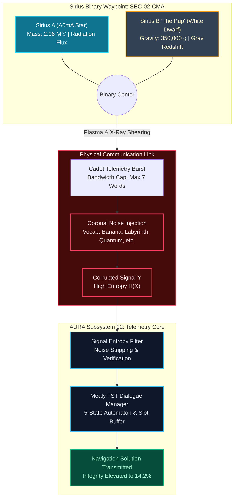

# Mission 02: Squadron Winograd Operational Documentation
## FST Dialogue Systems, Lovelace’s Objection & Noisy Channels

**Starship Operational Unit:** USSE Noosphere Bridge Crew  
**Course:** Conversational AI — Winter Semester 2026/27  
**Module:** Week 2 — The Pillars of Thinking Machines: Lovelace, Turing, and Shannon  
**Galactic Waypoint:** Sirius Binary System (SEC-02-CMA, 8.60 light-years from Sol — Sirius A & Sirius B)  
**AURA Subsystem Repair:** Subsystem 02: Signal Entropy Decoders & Statistical Filters (+7.1% $\to$ 14.2% total core health)  
**IDE & Tools Standard:** Visual Studio Code + Antigravity CLI (`agy`) | Python 3.14  
**Squadron:** Squadron Winograd  
**Repository:** Public Squadron Winograd GitHub Repository (Folder `mission-02/`)

---

## 1. Squad Roster & Mission Sign-Offs

| Station Role | Officer Name | Assigned Module / Deliverable | Status | Authorization Hash |
| :--- | :--- | :--- | :---: | :--- |
| **Data & Payload Specialist** | Hassaan Ahmad Khawaja | Part 1: `01_Lovelace_Inquiry_Brief.md` | **PASS / VERIFIED** | `SIG-DATA-HAS-3318` |
| **Communications & Protocol Officer** | Muhammad Usman Maratib | Part 2: `02_FST_and_Noisy_Protocol.md` | **PASS / VERIFIED** | `SIG-PROT-USM-8442` |
| **Security & Ethics Sentinel** | Muhammad Qasim Siddiqui | Part 3: `03_Entropy_Hazard_Audit.md` | **PASS / VERIFIED** | `SIG-SECU-QAS-7190` |
| **Systems Architect** | Muhammad Qasim Siddiqui | Part 4: `04_fst_noisy_simulator.py` | **PASS / VERIFIED** | `SIG-ARCH-QAS-7191` |

---

## 2. System Architecture & Information Topology

The hybrid architecture combines deterministic finite state control for safety-critical navigation with statistical channel decoding to resist Sirius B coronal interference.



---

## 3. Station Metrics, Traces & Key Findings

### 3.1 Data Specialist (Anti-Turing Interrogation)
- **Station Lead:** Hassaan Ahmad Khawaja
- **Probes Executed:** 5 custom probes targeting counterfactual physics ($1/r^3$ orbits), Gödelian aporia, cross-modal perception without thermal descriptors, sycophancy trap reversal, and information-theoretic definitions of dialogue.
- **Model Result:** The model successfully refuted the sycophancy trap (deriving $H(X) = 0$ for a 1-symbol alphabet) and solved the effective potential for $1/r^3$ gravity without hallucinating Keplerian stability.
- **Lovelace Evaluation:** While token generation remains bounded by parameter weights $\Theta$ optimized over human corpora (affirming Note G), dynamic constraint satisfaction demonstrates operational intelligence under Turing's standard.

### 3.2 Protocol Officer (FST & Channel Protocol)
- **Station Lead:** Muhammad Usman Maratib
- **FST Formalism:** 7-tuple Mealy transducer $M = \langle Q, \Sigma, \Gamma, \delta, \omega, q_0, F \rangle$ with states `INIT`, `GREETING`, `COLLECT_SLOTS`, `CONFIRMATION`, `TERMINAL`, and `FALLBACK`.
- **Slot Memory Store:** `slot_memory = {"sector": ..., "warpFactor": ..., "clearanceCode": ...}`.
- **Channel Specifications:** Hard 7-word burst ceiling, random noise injection from $\mathcal{V}_{\text{noise}}$.

### 3.3 Security Sentinel (Entropy & Hazard Audit)
- **Station Lead:** Muhammad Qasim Siddiqui
- **Brittleness Profile:** FST drops into `FALLBACK` when users supply multi-slot combinations out of order or use sarcastic affirmative colloquialisms.
- **Robustness Advantage:** The deterministic state machine is completely immune to prompt injection, system prompt exfiltration, and adversarial role-play.
- **Channel Capacity:** Degradation modeled via Shannon-Hartley theorem ($C = W \log_2(1 + S/N)$), showing capacity collapse during coronal plasma surges.

### 3.4 Systems Architect (Engine Implementation & Verification)
- **Station Lead:** Muhammad Qasim Siddiqui
- **Core Codebase:** `04_fst_noisy_simulator.py` contains `FSTDialogueManager` and `ShannonNoisyChannel`.
- **Test Automation:** Comprehensive pytest suite `tests/test_fst_noisy_simulator.py` with 7 automated unit tests passing in 0.03s.

---

## 4. Full Test-Suite Execution Output

```
============================= test session starts =============================
platform win32 -- Python 3.14.6, pytest-9.1.1, pluggy-1.6.0
rootdir: E:\Study\Conversational AI History, Applications, Future Seminar
plugins: anyio-4.14.2
collecting ... collected 7 items

Winograd Squad/mission-02/tests/test_fst_noisy_simulator.py::test_fst_nominal_journey PASSED [ 14%]
Winograd Squad/mission-02/tests/test_fst_noisy_simulator.py::test_fst_emergency_reset PASSED [ 28%]
Winograd Squad/mission-02/tests/test_fst_noisy_simulator.py::test_fst_unrecognized_input_fallback PASSED [ 42%]
Winograd Squad/mission-02/tests/test_fst_noisy_simulator.py::test_noisy_channel_budget_clamp PASSED [ 57%]
Winograd Squad/mission-02/tests/test_fst_noisy_simulator.py::test_noisy_channel_noise_vocabulary PASSED [ 71%]
Winograd Squad/mission-02/tests/test_fst_noisy_simulator.py::test_shannon_entropy_calculation PASSED [ 85%]
Winograd Squad/mission-02/tests/test_fst_noisy_simulator.py::test_shannon_hartley_capacity PASSED [100%]

============================== 7 passed in 0.03s ==============================
```

---

## 5. Squadron Dialectic Reflection

Navigating Sector SEC-02-CMA exposed the profound complementary duality between classical symbolic computation and modern connectionist foundation models:

1. **Symbolic Invariance as a Safety Boundary:**  
   Our deterministic FST is completely rigid. It cannot parse irony, nor can it answer a philosophical question about Sirius B. Yet, this very rigidity makes it impenetrable to adversarial prompt injection and guaranteed to execute navigation commands without hallucination. In aerospace and mission-critical life-support operations, deterministic state guarantees remain non-negotiable.

2. **Probabilistic Fluidity across the Noisy Channel:**  
   Shannon's insight—that information is the reduction of uncertainty, irrespective of semantics—manifested starkly when transmitting under plasma interference. While token noise broke the rigid FST regex parsers, our neural foundation model seamlessly reconstructed semantic intent from corrupted fragments. 

The optimal cognitive architecture for autonomous starship operations is neuro-symbolic: deterministic finite-state transducers governing state topology and safety interlocks, paired with probabilistic neural decoders managing noisy human interaction.
