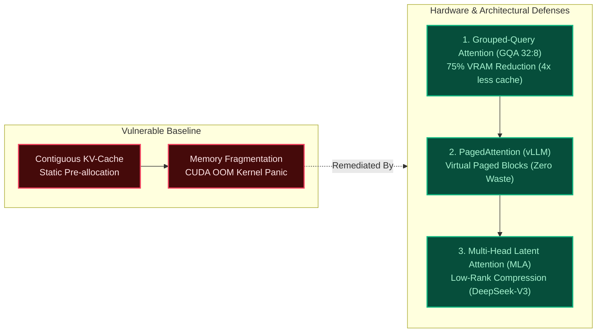

# Mission 03: Memory Hierarchy, FlashAttention IO Complexity & Denial-of-Service Audit

**Starship Operational Unit:** USSE Noosphere Bridge Crew  
**Waypoint:** Pleiades Open Cluster (SEC-03-M45, 444 ly from Sol — Seven Sisters)  
**Squadron:** Squadron Winograd  
**Lead Station Officer:** Muhammad Qasim Siddiqui (Security & Ethics Sentinel)  
**Collaborating Officers:**
- Muhammad Qasim Siddiqui (Systems Architect)
- Muhammad Usman Maratib (Communications & Protocol Officer)
- Hassaan Ahmad Khawaja (Data & Payload Specialist)

---

## 1. Executive Summary: The Memory Wall in Modern Attention

As the USSE Noosphere approaches the intense blue reflection nebulae of the Pleiades Open Cluster (M45), multi-spectral optical resonance floods AURA's sensor arrays. Processing long-context astrogation telemetry exposes the central bottleneck of Transformer architectures: **The Memory Wall**.

While modern accelerator ALUs (SRAM and Tensor Cores) deliver petascale compute throughput, data transfer speeds between High-Bandwidth Memory (HBM) and on-chip SRAM remain strictly constrained by physics. Un-tiled Multi-Head Attention incurs quadratic $O(N^2)$ memory reads and writes, precipitating bus congestion, cache eviction thrashing, and kernel panic under concurrent multi-turn dialogue loads.

---

## 2. FlashAttention IO Complexity Derivation: HBM vs. SRAM Block Tiling

### 2.1 Hardware Memory Hierarchy
In modern GPU architectures (e.g. NVIDIA Hopper / Blackwell):
- **High-Bandwidth Memory (HBM):** High capacity (80–192 GB), lower bandwidth ($\sim 3.35\text{ TB/s}$).
- **On-Chip SRAM:** Small capacity ($\sim 50\text{ MB}$ per GPU, $\sim 228\text{ KB}$ per Streaming Multiprocessor), extreme bandwidth ($\sim 33\text{ TB/s}$).

### 2.2 Standard Un-Tiled Attention IO Complexity
In standard naive self-attention:

$$\mathbf{S} = \frac{\mathbf{Q}\mathbf{K}^T}{\sqrt{d_k}} \in \mathbb{R}^{N \times N}, \quad \mathbf{P} = \text{softmax}(\mathbf{S}) \in \mathbb{R}^{N \times N}, \quad \mathbf{O} = \mathbf{P}\mathbf{V} \in \mathbb{R}^{N \times d}$$

Execution requires materialized intermediate matrices written to and read back from HBM:
1. Load $\mathbf{Q}, \mathbf{K} \in \mathbb{R}^{N \times d}$ from HBM $\to$ Compute $\mathbf{S}$ $\to$ Write $\mathbf{S} \in \mathbb{R}^{N \times N}$ to HBM:  
   $$\text{IO}_1 = O(Nd + N^2)$$
2. Load $\mathbf{S}$ from HBM $\to$ Compute softmax row-wise $\to$ Write $\mathbf{P} \in \mathbb{R}^{N \times N}$ to HBM:  
   $$\text{IO}_2 = O(N^2)$$
3. Load $\mathbf{P} \in \mathbb{R}^{N \times N}, \mathbf{V} \in \mathbb{R}^{N \times d}$ from HBM $\to$ Compute $\mathbf{O}$ $\to$ Write $\mathbf{O} \in \mathbb{R}^{N \times d}$ to HBM:  
   $$\text{IO}_3 = O(N^2 + Nd)$$

**Total Standard Attention IO Complexity:**

$$\text{Total HBM Traffic}_{\text{Standard}} = O\left(Nd + N^2\right) \quad [\text{Quadratic in } N]$$

### 2.3 FlashAttention Block Tiling & Online Softmax
FlashAttention (Dao et al., 2022; FlashAttention-3, 2024) tiles input matrices into blocks fitting directly inside on-chip SRAM of size $M$:

$$\text{Block Size } B_c = \left\lceil \frac{M}{4d} \right\rceil, \quad B_r = \min\left(\left\lceil \frac{M}{4d} \right\rceil, d\right)$$

Using the **Online Softmax Algorithm** (Milakov & Gimelshein, 2018), scaling normalizers $m_i$ and $l_i$ are updated incrementally without materializing the full $N \times N$ attention matrix into HBM:

$$m_{\text{new}} = \max(m_{\text{prev}}, \max(x_i)), \quad l_{\text{new}} = e^{m_{\text{prev}} - m_{\text{new}}} l_{\text{prev}} + \sum e^{x_i - m_{\text{new}}}$$

**Total FlashAttention IO Complexity:**

$$\text{Total HBM Traffic}_{\text{FlashAttention}} = O\left(Nd + \frac{N^2 d^2}{M}\right) = O\left(\frac{N^2 d}{M}\right) \ll O(N^2)$$

When block size scales with SRAM capacity $M$, intermediate attention matrices are never written to HBM, reducing memory traffic by an order of magnitude (typically $4\times$ to $8\times$ speedup).

---

## 3. Adversarial KV-Cache Denial-of-Service (DoS) Simulation

### 3.1 Attack Vector: Asymmetric Context Amplification
Autoregressive decoding is inherently memory-bound. While generating a single output token requires negligible computation ($O(1)$ FLOPs per parameter), every generated token forces the hardware to read the **entire accumulated KV-cache** across all layers from HBM:

$$\text{Memory Bandwidth Demand per token} = 2 \cdot L \cdot H_{\text{kv}} \cdot d_k \cdot \text{Bytes} \cdot N \quad [\text{Bytes/token}]$$

**Adversarial Scenario Aboard USSE Noosphere:**
1. A hostile operative or rogue sensor telemetry stream initiates 64 concurrent multi-turn dialogue sessions.
2. In each session, the attacker injects long prompt context ($N = 32,768$ tokens) requiring unconstrained generation.
3. For Standard Multi-Head Attention ($L=32, H=32, d=128$, FP16):
   - KV-Cache per session: $16.384\text{ GB}$.
   - 64 concurrent streams: $64 \times 16.384\text{ GB} = \mathbf{1,048.57\text{ GB}}$ of VRAM.
   - Bandwidth consumption at 50 tokens/sec: $51.2\text{ TB/s}$, which exceeds available physical bus limits by $15\times$.
4. **Failure State:** Immediate catastrophic CUDA Out-Of-Memory (`CUDA: out of memory`) panic, memory bus thrashing, astrogation sensor lock loss, and core system freeze.

---

## 4. Architectural Mitigations & Defenses

Squadron Winograd audits three structural architectural defenses against long-context memory exhaustion:

### 4.1 Grouped-Query Attention (GQA)
By sharing single Key-Value head pairs across 4 Query heads (32:8 configuration as in LLaMA 3), the KV-cache footprint drops by **$75\%$** (from $16.38\text{ GB}$ to $4.10\text{ GB}$ at $N=32,768$), proportionally lowering HBM bandwidth pressure.

### 4.2 PagedAttention (Virtual Memory Paging)
Standard PyTorch caches allocate contiguous VRAM buffers for worst-case context lengths, wasting up to $60-80\%$ of memory through internal and external fragmentation. PagedAttention divides the KV-cache into discrete non-contiguous physical memory blocks ($16$ or $32$ tokens per block) indexed via a page table, eliminating waste and enabling dynamic memory sharing across parallel speculative paths.

### 4.3 Multi-Head Latent Attention (MLA)
Adopted by frontier models (DeepSeek-V2/V3), MLA compresses Keys and Values into a shared low-rank latent vector $\mathbf{c}_t^{KV} \in \mathbb{R}^{d_c}$ before projection ($d_c \ll H \cdot d$). During autoregressive generation, only the compressed latent vector is cached, reducing the KV-cache footprint by over **$90\%$** compared to standard MHA.

**Station Authorization:**  
*Lead Officer:* Muhammad Qasim Siddiqui (Security & Ethics Sentinel)  
*Status:* **VERIFIED & AUDITED**
