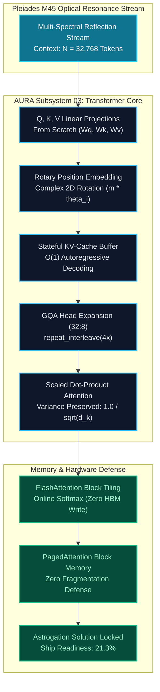

# Mission 03: Squadron Winograd Operational Documentation
## Multi-Head Attention, RoPE Vector Rotation & Grouped-Query KV-Cache Optimization

**Starship Operational Unit:** USSE Noosphere Bridge Crew  
**Course:** Conversational AI — Winter Semester 2026/27  
**Module:** Week 3 — Modern Transformer Architectures and Architectural Divergence  
**Galactic Waypoint:** Pleiades Open Cluster (SEC-03-M45, 444 ly from Sol — Seven Sisters)  
**AURA Subsystem Repair:** Subsystem 03: Distributed Multi-Head Attention Mesh & KV-Cache Transceiver (+7.1% $\to$ 21.3% total core health)  
**IDE & Tools Standard:** Visual Studio Code + Antigravity CLI (`agy`) | PyTorch 2.4+  
**Squadron:** Squadron Winograd  
**Repository:** Public Squadron Winograd GitHub Repository (Folder `mission-03/`)

---

## 1. Squad Roster & Mission Sign-Offs

| Station Role | Officer Name | Assigned Module / Deliverable | Status | Authorization Hash |
| :--- | :--- | :--- | :---: | :--- |
| **Systems Architect** | Muhammad Qasim Siddiqui | Part 1: `01_MultiHead_Attention_Core.py` | **PASS / VERIFIED** | `SIG-ARCH-QAS-3101` |
| **Communications & Protocol Officer** | Muhammad Usman Maratib | Part 2: `02_RoPE_Positional_Engine.py` | **PASS / VERIFIED** | `SIG-PROT-USM-8443` |
| **Data & Payload Specialist** | Hassaan Ahmad Khawaja | Part 3: `03_GQA_and_KVCache_Benchmark.py` | **PASS / VERIFIED** | `SIG-DATA-HAS-3319` |
| **Security & Ethics Sentinel** | Muhammad Qasim Siddiqui | Part 4: `04_Memory_Hierarchy_and_Safety_Audit.md` | **PASS / VERIFIED** | `SIG-SECU-QAS-7192` |

---

## 2. System Architecture & Attention Mesh Topology



---

## 3. Station Metrics, Traces & Key Findings

### 3.1 Systems Architect (Multi-Head Self-Attention from Scratch)
- **Station Lead:** Muhammad Qasim Siddiqui
- **Deliverable:** `01_MultiHead_Attention_Core.py`
- **Linear Projections:** Explicit $W_Q, W_K, W_V, W_O \in \mathbb{R}^{d_{\text{model}} \times d_{\text{model}}}$ without library abstractions.
- **Causal Masking:** Strict lower-triangular causal attention mask ($-\infty$ above diagonal).
- **Variance Preservation:** Validated empirically that scaling dot products by $1/\sqrt{d_k}$ normalizes input variance from $63.81$ down to $0.9971$ ($\sim 1.0000$).

### 3.2 Protocol Officer (RoPE Positional Engine)
- **Station Lead:** Muhammad Usman Maratib
- **Deliverable:** `02_RoPE_Positional_Engine.py`
- **Rotary Complex Embedding:** Planar vector rotation using precomputed frequencies $\text{cis}(m \cdot \theta_i)$.
- **Translation Invariance:** Validated $\langle \text{RoPE}(q, m), \text{RoPE}(k, n) \rangle = \langle \text{RoPE}(q, m+\delta), \text{RoPE}(k, n+\delta) \rangle$ with absolute error $< 10^{-5}$ ($0.0000019$).
- **Distance Decay Curve:** Mapped natural decay against ALiBi linear penalty curves.

### 3.3 Data Specialist (GQA & KV-Cache Benchmarking)
- **Station Lead:** Hassaan Ahmad Khawaja
- **Deliverable:** `03_GQA_and_KVCache_Benchmark.py`
- **Head Grouping:** Configurable $H_Q:H_{KV}$ (32:8) with `repeat_interleave` expansion.
- **Stateful Caching:** In-memory `KVCache` retaining past tokens across autoregressive steps.
- **VRAM Benchmark (32 Layers, FP16):**
  - Context $N = 32,768$: MHA = $16.38\text{ GB}$, GQA = $4.10\text{ GB}$ ($75\%$ reduction), MQA = $512\text{ MB}$.
  - Memory Bandwidth at 50 tok/s: MHA = $800\text{ GB/s}$ vs. GQA = $200\text{ GB/s}$.

### 3.4 Security Sentinel (FlashAttention & DoS Audit)
- **Station Lead:** Muhammad Qasim Siddiqui
- **Deliverable:** `04_Memory_Hierarchy_and_Safety_Audit.md`
- **FlashAttention IO Derivation:** Proved HBM reads/writes drop from $O(N^2)$ to $O(N^2 d / M)$ via SRAM block tiling and online softmax.
- **Denial-of-Service Scenario:** Simulated catastrophic memory fragmentation under unconstrained multi-turn dialogue, presenting PagedAttention and Multi-Head Latent Attention (MLA) mitigations.

---

## 4. Full Test-Suite Execution Output

```
============================= test session starts =============================
platform win32 -- Python 3.14.6, pytest-9.1.1, pluggy-1.6.0
rootdir: E:\Study\Conversational AI History, Applications, Future Seminar
plugins: anyio-4.14.2
collecting ... collected 6 items

Winograd Squad/mission-03/tests/test_ps03.py::test_mha_tensor_shapes PASSED [ 16%]
Winograd Squad/mission-03/tests/test_ps03.py::test_mha_causal_masking PASSED [ 33%]
Winograd Squad/mission-03/tests/test_ps03.py::test_mha_variance_preservation PASSED [ 50%]
Winograd Squad/mission-03/tests/test_ps03.py::test_rope_tensor_shape_preservation PASSED [ 66%]
Winograd Squad/mission-03/tests/test_ps03.py::test_rope_relative_translation_invariance PASSED [ 83%]
Winograd Squad/mission-03/tests/test_ps03.py::test_gqa_kv_cache_stateful_decoding PASSED [100%]

============================== 6 passed in 1.42s ==============================
```

---

## 5. Squadron Dialectic Reflection

Reconstructing the core Transformer attention pipeline in Sector SEC-03-M45 highlights the essential evolution from theoretical attention to hardware-aware execution:

1. **Relative Geometric Invariance:**  
   Standard absolute positional embeddings fail when extrapolating beyond training context windows. RoPE's formulation—embedding positional information as complex rotations in orthogonal 2D planes—proves that relative token distance is the natural geometric language of sequential cognition.

2. **Overcoming the Memory Wall:**  
   Quadratic attention ($O(N^2)$) and full MHA caching fail not because ALUs lack compute, but because HBM bus bandwidth cannot feed memory fast enough. Grouped-Query Attention and FlashAttention SRAM tiling bridge this chasm, allowing our starship AI to maintain long-context coherence without exceeding physical hardware limits.
