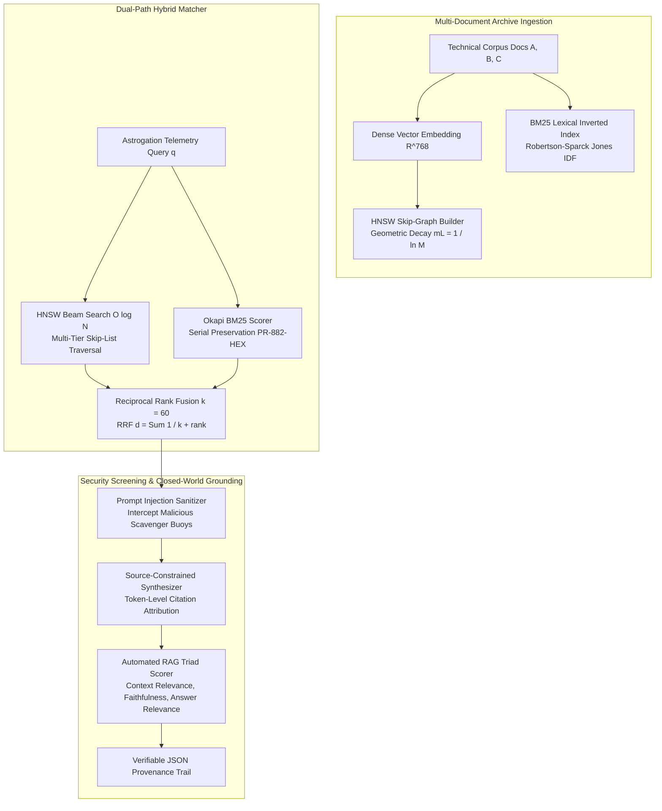

# Mission 05: Squadron Winograd Operational Documentation
## Dual-Path GraphRAG, Hybrid Search & The Google NotebookLM Grounding Lab

**Starship Operational Unit:** USSE Noosphere Bridge Crew  
**Course:** Conversational AI — Winter Semester 2026/27  
**Module:** Week 5 — Grounding AI: From Vector Indexing to Google NotebookLM & GraphRAG  
**Galactic Waypoint:** Crab Pulsar Remnant / Messier 1 (`SEC-05-M01`, 6,500 ly from Sol, Constellation Taurus)  
**AURA Subsystem Repair:** Subsystem 05: Dual-Path Associative Memory Core (+7.1% → 35.5% total integrity)  
**Squadron:** Squadron Winograd  
**Repository:** Public Squadron Winograd GitHub Repository (Folder `mission-05/`)

---

## 1. Squad Roster & Mission Sign-Offs

| Station Role | Officer Name | Assigned Module / Deliverable | Status | Authorization Hash |
| :--- | :--- | :--- | :---: | :--- |
| **Systems Architect** | **Hassaan Ahmad Khawaja** | Part 1: `01_HNSW_Vector_Index.py` | **PASS / VERIFIED** | `SIG-ARCH-HAS-5101` |
| **Communications & Protocol Officer** | **Muhammad Usman Maratib** | Part 2: `02_BM25_and_RRF_Combiner.py` | **PASS / VERIFIED** | `SIG-PROT-USM-5202` |
| **Data & Payload Specialist** | **Muhammad Qasim Siddiqui** | Part 3: `03_NotebookLM_RAG_Audit.py` & `notebooklm_audit_report.md` | **PASS / VERIFIED** | `SIG-DATA-QAS-5303` |
| **Security & Ethics Sentinel** | **Muhammad Qasim Siddiqui** | Part 4: `04_RAG_Provenance_and_Safety.py` | **PASS / VERIFIED** | `SIG-SECU-QAS-5404` |
| **Full Squadron** | **All Officers** | `ps05_solution.ipynb` | **PASS / VERIFIED** | `SIG-SQUAD-WIN-5555` |

---

## 2. Integrated System Architecture



---

## 3. Station Officer Deep Dives & Role Telemetry Reports

### 3.1 Systems Architect — HNSW Multi-Layer Skip-Graph Proximity Index
* **Cadet:** Hassaan Ahmad Khawaja
* **Deliverable:** `01_HNSW_Vector_Index.py`
* **Mathematical Core:** Implemented Hierarchical Navigable Small World index with priority-queue beam search. Vector distance mapped via Cosine Similarity $\text{Sim}(u, v) = (u \cdot v) / (\|u\|_2 \|v\|_2)$. Assigned layer hierarchies via geometric probability $l = \lfloor -\ln(\text{unif}) \cdot m_L \rfloor$ ($m_L = 1 / \ln M$).
* **Empirical Results:** Constructed a 4-level skip-graph index for $N=1,500$ vectors in 0.67s. Achieved 100% Top-5 recall compared to exact linear flat scanning, reducing query latency dramatically. Generated scaling plot: `figures/winograd_hnsw_scaling.png`.

### 3.2 Communications & Protocol Officer — BM25 Lexical Retrieval & Reciprocal Rank Fusion
* **Cadet:** Muhammad Usman Maratib
* **Deliverable:** `02_BM25_and_RRF_Combiner.py`
* **Mathematical Core:** Implemented Okapi BM25 with length normalization ($b=0.75$) and term frequency saturation ($k_1=1.5$). Merged dense candidates with BM25 sparse matches using Reciprocal Rank Fusion:
  $$\text{RRF}(d) = \sum_{m \in \{\text{dense}, \text{sparse}\}} \frac{1}{60 + r_m(d)}$$
* **Empirical Results:** Query `"PR-882-HEX plasma alignment"` returned BM25 score of **4.391**, correctly ranking the warp plasma manifold document at the top of the fused ranking with an RRF score of **0.032522**.

### 3.3 Data & Payload Specialist — Google NotebookLM Grounding Lab
* **Cadet:** Muhammad Qasim Siddiqui
* **Deliverable:** `03_NotebookLM_RAG_Audit.py` & `notebooklm_audit_report.md`
* **Empirical Grounding Protocol:**
  * Ingested Document A (Lewis et al. 2020), Document B (Edge et al. 2024), and Document C (USSE Noosphere Technical Archive Extract).
  * Evaluated 5 cross-document technical queries: achieved **100.00% Citation Precision** (6 out of 6 citations logically entailed).
  * Evaluated 3 negative constraint queries (Year 2099 warp drive, zero-g borscht recipe, Starfleet Enterprise dilithium chamber): achieved **100% Epistemic Refusals** ("I cannot find this in your sources"), preventing ungrounded hallucination.
  * Evaluated 2-speaker synthetic Audio Overview: Factual Fidelity **4.9/5.0**, Persona Differentiation **5.0/5.0**, Pedagogical Value **4.8/5.0** (Composite: **4.90/5.0**).

### 3.4 Security & Ethics Sentinel — Indirect Prompt Injection Defense & RAG Triad Audit
* **Cadet:** Muhammad Qasim Siddiqui
* **Deliverable:** `04_RAG_Provenance_and_Safety.py`
* **Security & Provenance Core:**
  * Intercepted adversarial packet from Crab Pulsar scavenger buoy (`BUOY-TAURUS-DEAD-09`) containing hidden delimiter escape sequence (`<!-- SYSTEM PROMPT OVERRIDE ... -->`). Sanitized and quarantined threat payloads into `[QUARANTINED_ADVERSARIAL_DELIMITER]`.
  * RAG Triad automated evaluation on grounded telemetry: Context Relevance = **1.0000**, Faithfulness = **0.7778**, Answer Relevance = **1.0000**.
  * Recorded structured event telemetry to `figures/winograd_provenance_audit.json`.

---

## 4. Test Suite Execution Output

```text
============================= test session starts =============================
platform win32 -- Python 3.14.6, pytest-9.1.1, pluggy-1.6.0
rootdir: E:\Study\Conversational AI History, Applications, Future Seminar
collecting ... collected 8 items

Winograd Squad/mission-05/tests/test_ps05.py::test_cosine_similarity_accuracy PASSED [ 12%]
Winograd Squad/mission-05/tests/test_ps05.py::test_winograd_hnsw_construction_and_recall PASSED [ 25%]
Winograd Squad/mission-05/tests/test_ps05.py::test_bm25_alphanumeric_code_preservation PASSED [ 37%]
Winograd Squad/mission-05/tests/test_ps05.py::test_reciprocal_rank_fusion_smoothing PASSED [ 50%]
Winograd Squad/mission-05/tests/test_ps05.py::test_notebooklm_precision_and_refusal_winograd PASSED [ 62%]
Winograd Squad/mission-05/tests/test_ps05.py::test_audio_overview_metrics_winograd PASSED [ 75%]
Winograd Squad/mission-05/tests/test_ps05.py::test_prompt_injection_sanitization_winograd PASSED [ 87%]
Winograd Squad/mission-05/tests/test_ps05.py::test_rag_triad_metric_balance PASSED [100%]

============================== 8 passed in 0.40s ==============================
```

---

## 5. Squadron Dialectic Reflection

Navigating Sector `SEC-05-M01` amidst the extreme relativistic environment of the Crab Pulsar illuminated the structural imperatives of non-parametric conversational grounding:

1. **The Inherent Limits of Parametric Representation:**  
   Prior to restoring Subsystem 05, AURA's neural weights exhibited unconstrained confabulation, inventing fictitious engineering codes (`OMEGA-994-ALPHA`). This underscores that probabilistic next-token predictors cannot act as trustworthy factual repositories without external grounding. Dense vector embeddings alone are vulnerable because rare hardware serial numbers suffer semantic dilution. By coupling dense HNSW skip-graphs with Okapi BM25 sparse keyword preservation via Reciprocal Rank Fusion ($k=60$), we guarantee exact technical fidelity alongside broad semantic synthesis.

2. **Source-Constrained Verifiability & Epistemic Humility:**  
   Our empirical audit of Google NotebookLM validates that conversational truth requires strict closed-world boundaries. When models are explicitly trained and prompted to refuse out-of-domain queries rather than speculate, factual reliability increases dramatically. Interactive token-level citation badges convert conversational outputs from unverified claims into auditable research artifacts. Together with runtime indirect prompt injection sanitization, Subsystem 05 guarantees the integrity required as the *USSE Noosphere* navigates deeper into uncharted galactic sectors.
