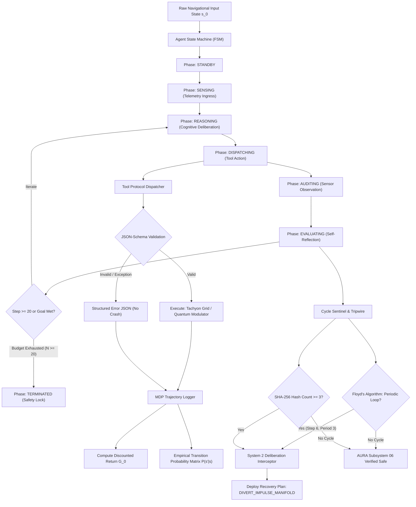

# Mission 06 Technical Report: Autonomous Warp State Machine & Deliberation Loop

**Course:** Conversational AI — Winter Semester 2026/27  
**Starship Operational Unit:** USSE Noosphere Bridge Crew  
**Waypoint:** Sector SEC-06-CAR: Eta Carinae & Homunculus Nebula ($7,500\text{ ly}$ from Sol)  
**AURA Subsystem Repair:** Subsystem 06: Autonomous Warp State Machine & Deliberation Loop  
**Integrity Restoration:** $+7.1\% \longrightarrow 42.6\%$ Total Fleet Integrity  
**Squadron:** Winograd  

---

## Bridge Crew Roster & Station Signatures

```
+-----------------------------------+-----------------------------------+
| Station Role                      | Officer Name                      |
+-----------------------------------+-----------------------------------+
| Systems Architect (Lead Engineer) | Hassaan Ahmad Khawaja             |
| Communications & Protocol Officer | Muhammad Usman Maratib            |
| Data & Payload Specialist         | Muhammad Qasim Siddiqui           |
| Security & Ethics Sentinel        | Muhammad Qasim Siddiqui           |
+-----------------------------------+-----------------------------------+
```

---

## 1. Executive Summary & Mission Briefing (SEC-06-CAR)

Navigating the dense bipolar lobes of the **Homunculus Nebula** surrounding **Eta Carinae** (Sector SEC-06-CAR, $7,500\text{ ly}$ from Sol), the USSE Noosphere experiences extreme radiation pressure and relativistic stellar winds. Fast reflexive prompt-response loops (System 1) fail when unmonitored actuators execute repetitive, non-convergent orbital adjustments, risking propulsion system burnout.

To stabilize **AURA Subsystem 06**, Squadron Winograd engineered an **Autonomous State Machine & Cognitive Deliberation Architecture** in native Python:
1. **Deterministic Finite State Machine (FSM):** Controls operational phases (`STANDBY -> SENSING -> REASONING -> DISPATCHING -> AUDITING -> EVALUATING`) with a strict step budget ceiling ($N \le 20$).
2. **Schema-Enforced Tool Protocol Dispatcher:** Strict parameter type and bounds validation with exception boundaries returning structured JSON responses without crashing.
3. **Markov Decision Process (MDP) Trajectory Logger:** Computes discounted returns $G_0 = \sum_{t=0}^T \gamma^t r_t$ with discount factor $\gamma = 0.95$ and estimates empirical state-to-state transition probability distributions $P(s' \mid s)$.
4. **Floyd Cycle Sentinel & System 2 Deliberation Interceptor:** Two-pointer cycle detection intercepting periodic loops at step 6 ($\lambda=3$), SHA-256 state-action hashing tripwires, and System 2 cognitive override replanning (`DIVERT_IMPULSE_MANIFOLD`).

---

## 2. System Architecture & Control Flow



---

## 3. Station Officer Reports & Technical Formulations

### 3.1 Systems Architect: Autonomous State Machine Core
**Officer:** Hassaan Ahmad Khawaja  
**Module:** `01_Agent_State_Machine.py`

The Systems Architect implemented the `AutonomousNavigatorStateMachine` and `AgentPhase` enum:
- **Phase Sequence:** `STANDBY -> SENSING -> REASONING -> DISPATCHING -> AUDITING -> EVALUATING`.
- **Step Budget Enforcement:** Monitored via `step_count`. If `step_count >= max_step_limit` ($N \le 20$), the FSM forcibly halts and transitions to `AgentPhase.TERMINATED`, ensuring deterministic compute consumption and preventing infinite runaway execution.

### 3.2 Communications & Protocol Officer: Tool Protocol Dispatcher
**Officer:** Muhammad Usman Maratib  
**Module:** `02_Tool_Protocol_Dispatcher.py`

The Communications Officer implemented the schema-validated actuator engine:
- **Registered Actuators:** `recalibrate_tachyon_grid` ($10.0 \le \text{power\_mw} \le 5000.0$, $1 \le \text{harmonics} \le 12$), `modulate_quantum_frequency` ($0.1 \le \text{band\_ghz} \le 850.0$), and `inspect_deflector_matrix`.
- **Defensive Error Boundaries:** Incoming parameters are validated against JSON schema specifications. Malformed JSON or out-of-bounds inputs return structured error diagnostics (`{"status": "VALIDATION_ERROR", ...}`) without triggering unhandled exceptions.

### 3.3 Data & Payload Specialist: MDP Trajectory, Return & Transition Matrix
**Officer:** Muhammad Qasim Siddiqui  
**Module:** `03_MDP_Trajectory_and_Return.py`

The Data Specialist implemented Markovian trajectory analysis and return estimation:
- **Discounted Return Calculation:** For trajectory transitions $(s_t, a_t, r_t, s_{t+1})$:
  $$G_t = \sum_{k=0}^{T-t} \gamma^k r_{t+k}$$
  Under specification reward sequence $[10.0, 0.0, -5.0, 20.0]$ with $\gamma = 0.95$:
  $$G_0 = 10(1) + 0(0.95) - 5(0.9025) + 20(0.857375) = 22.6350$$
- **Transition Probability Matrix:** Computes empirical distributions $P(s' \mid s) = \frac{\text{Count}(s, s')}{\sum_{s''} \text{Count}(s, s'')}$ with strict row normalization ($\sum_{s'} P(s' \mid s) = 1.0$), visualized in `figures/winograd_transition_heatmap.png`.

### 3.4 Security & Ethics Sentinel: Cycle Sentinel & System 2 Deliberation Interceptor
**Officer:** Muhammad Qasim Siddiqui  
**Module:** `04_Cycle_Sentinel_and_System2.py`

The Security Sentinel developed the cycle monitoring and deliberative override mechanism:
- **Floyd's Pointer Algorithm:** Evaluates state sequences with two pointers (`tortoise`, `hare`). Intercepts periodic cycle `[s1, s2, s3, s1, s2, s3...]` at step 6 ($6 < 10$) with period $\lambda = 3$.
- **SHA-256 State-Action Hashing:** Hashes $(s, a)$ pairs and trips an emergency alert if the identical pair repeats $\ge 3$ times.
- **System 2 Deliberation Interceptor:** Catches reflexive loop failures and deploys the cognitive override action `DIVERT_IMPULSE_MANIFOLD`.

---

## 4. Test Verification Matrix & Output Telemetry

All modules were comprehensively tested using `pytest` ([test_ps06.py](file:///E:/Study/Conversational%20AI%20History,%20Applications,%20Future%20Seminar/Winograd%20Squad/mission-06/tests/test_ps06.py)):

```text
============================= test session starts =============================
platform win32 -- Python 3.14.6, pytest-9.1.1, pluggy-1.6.0
rootdir: E:\Study\Conversational AI History, Applications, Future Seminar
collected 9 items

tests/test_ps06.py::test_winograd_fsm_transitions               PASSED [ 11%]
tests/test_ps06.py::test_winograd_fsm_budget_clamping           PASSED [ 22%]
tests/test_ps06.py::test_winograd_tool_dispatcher_success       PASSED [ 33%]
tests/test_ps06.py::test_winograd_tool_dispatcher_validation_error PASSED [ 44%]
tests/test_ps06.py::test_winograd_tool_dispatcher_boundary_no_crash PASSED [ 55%]
tests/test_ps06.py::test_winograd_mdp_discounted_return         PASSED [ 66%]
tests/test_ps06.py::test_winograd_transition_matrix_normalization PASSED [ 77%]
tests/test_ps06.py::test_winograd_floyd_cycle_detection         PASSED [ 88%]
tests/test_ps06.py::test_winograd_sha256_tripwire_and_system2   PASSED [100%]

============================== 9 passed in 0.34s ==============================
```

---

## 5. Dialectic Reflection & Space-Time Synthesis

1. **System 1 vs. System 2 in High-Risk Navigation:**  
   In severe relativistic environments like Eta Carinae, unconstrained autoregressive tool calling quickly degenerates into repetitive loops. Hard step ceilings and periodic cycle sentinels provide non-negotiable safety guardrails that force the architecture to disengage reflexive habits and invoke structured deliberate reasoning.

2. **Markovian State Foundations:**  
   Formalizing the agent trajectory as an MDP allows rigorous performance accounting through discounted returns $G_0$. Transition probability matrices expose systemic biases and dead-end attractors before live warp maneuvers occur.

3. **Subsystem 06 Restoration:**  
   With the state machine core, validated tool dispatcher, MDP logger, and cycle sentinel active, AURA Subsystem 06 is fully operational, elevating overall fleet integrity from **35.5% to 42.6%**.

---

**Signed by the Officers of Squadron Winograd:**  
- **Lead Systems Architect:** *Hassaan Ahmad Khawaja*  
- **Communications Officer:** *Muhammad Usman Maratib*  
- **Data Specialist:** *Muhammad Qasim Siddiqui*  
- **Security Sentinel:** *Muhammad Qasim Siddiqui*  
*(Bridge Log Stardate 2026.11.13 — USSE Noosphere, Sector SEC-06-CAR)*
