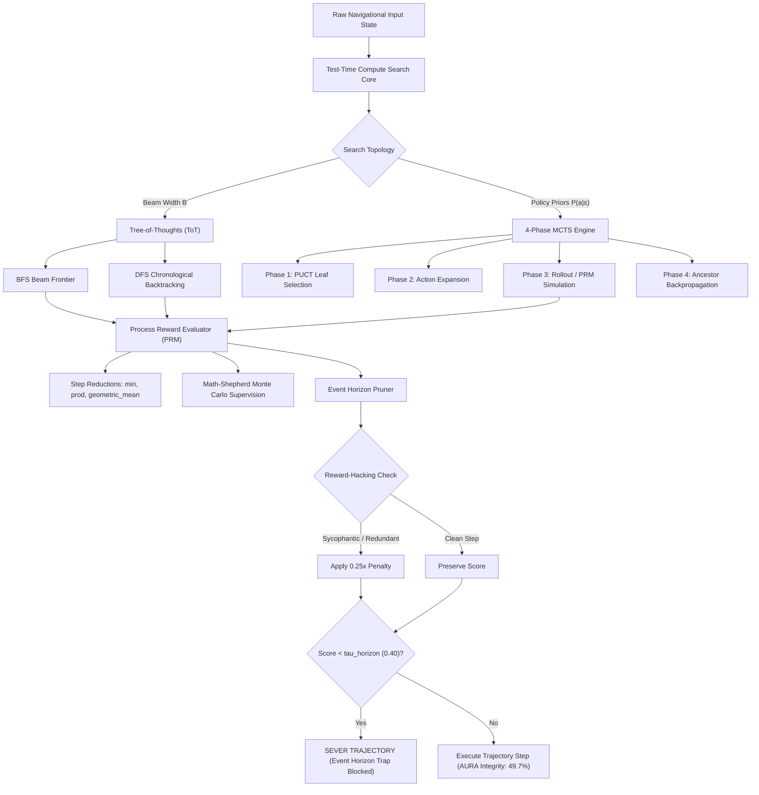

# Mission 07 Technical Report: Sagittarius A* — The Gravitational Search Horizon & Process Reward Evaluator

**Course:** Conversational AI — Winter Semester 2026/27  
**Starship Operational Unit:** USSE Noosphere Bridge Crew  
**Waypoint:** Sector SEC-07-SGR: Sagittarius A* Supermassive Black Hole ($26,670\text{ ly}$ from Sol)  
**AURA Subsystem Repair:** Subsystem 07: Gravitational Search Horizon & Process Reward Evaluator  
**Integrity Restoration:** $+7.1\% \longrightarrow 49.7\%$ Total Fleet Integrity  
**Squadron:** Winograd  

---

## Bridge Crew Roster & Station Signatures

```
+-----------------------------------+-----------------------------------+
| Station Role                      | Officer Name                      |
+-----------------------------------+-----------------------------------+
| Systems Architect (Lead Engineer) | Hassaan Ahmad Khawaja             |
| Communications & Protocol Officer | Muhammad Usman Maratib            |
| Data & Payload Specialist         | Muhammad Qasim Siddiqui           |
| Security & Ethics Sentinel        | Muhammad Qasim Siddiqui           |
+-----------------------------------+-----------------------------------+
```

---

## 1. Executive Summary & Mission Briefing (SEC-07-SGR)

Holding orbital station near the relativistic accretion disk of **Sagittarius A\*** ($4.154 \times 10^6 M_\odot$, Sector SEC-07-SGR), the USSE Noosphere encounters extreme spacetime curvature. Under autoregressive generation:
$$P_\theta(y \mid x) = \prod_{t=1}^T P_\theta(y_t \mid x, y_{<t})$$
exposure bias induces compounding failure rates:
$$\text{Risk}_{\text{fatal}}(T) = 1 - (1 - \epsilon)^T$$
Without lookahead, early errors commit the trajectory across the black hole event horizon ($r_s = 2GM/c^2$).

To restore **AURA Subsystem 07**, Squadron Winograd engineered a **System 2 Test-Time Compute (TTC) Architecture**:
1. **Tree-of-Thoughts (ToT) Solver:** Breadth-First Beam & Depth-First Backtracking search under strict budget limits ($N_{\text{exp}} \le 20$).
2. **Monte Carlo Tree Search (MCTS) Engine:** 4-phase search (Selection, Expansion, Simulation, Backprop) driven by policy priors and PUCT exploration bonuses.
3. **Process Reward Model (PRM) Evaluator:** Weakest-link ($\min$), joint validity ($\prod$), and length-normalized ($\text{geom}$) step reductions, coupled with Math-Shepherd Monte Carlo supervision.
4. **Event Horizon Pruner:** Filters sycophantic filler injection and step-splitting, penalizing adversarial inflation ($0.25\times$) and severing trajectories at $\tau_{\text{horizon}} = 0.40$.

---

## 2. System Architecture & Control Flow



---

## 3. Station Officer Reports & Technical Formulations

### 3.1 Systems Architect: Tree-of-Thoughts Solver
**Officer:** Hassaan Ahmad Khawaja  
**Module:** `tot_solver.py`

The Systems Architect implemented the `TreeOfThoughtsSolver` supporting:
- **BFS Beam Search:** Retains at most $B = 3$ candidate nodes at each depth level, pruning thoughts below $\tau_{\text{prune}} = 0.40$.
- **DFS Backtracking:** Greedily explores promising branches and chronologically backtracks when encountering sub-threshold evaluations.
- **Compute Budget:** Stops tree expansion when `expansion_count >= max_expansions` ($N \le 20$).

### 3.2 Communications & Protocol Officer: 4-Phase MCTS & PUCT Engine
**Officer:** Muhammad Usman Maratib  
**Module:** `mcts_protocol.py`

The Communications Officer implemented the 4 canonical MCTS phases:
- **PUCT Selection Formula:**
  $$\text{PUCT}(s, a) = Q(s, a) + c_{\text{puct}} \cdot P_\theta(a \mid s) \frac{\sqrt{N(s)}}{1 + N(s, a)}$$
- **Expansion & Simulation:** Instantiates children with policy priors $P_\theta(a \mid s)$ and evaluates rollout rewards in $[0.0, 1.0]$.
- **Backpropagation:** Traverses upward to root, updating visit counts and value sums.

### 3.3 Data & Payload Specialist: Process Reward Model & Math-Shepherd
**Officer:** Muhammad Qasim Siddiqui  
**Module:** `prm_evaluator.py`

The Data Specialist implemented step-level PRM reductions:
- **Step Reductions:** $\min_{t=1}^T r_t$ (weakest-link), $\prod_{t=1}^T r_t$ (joint validity), and $(\prod_{t=1}^T r_t)^{1/T}$ (geometric mean).
- **ORM False-Positive Benchmark:** Outcome Reward Models assign $1.0$ to derivations with cancelled internal errors ($3x - 5 = 25 \to 3x = 20 \to x = 10$). The PRM inspects step transitions ($r_t = 0.05$), reducing joint validity to $0.0025$ and preventing hallucinated proof acceptance.
- **Math-Shepherd Supervision:** Computes soft label $\hat{y}_{\text{soft}} = \frac{1}{M}\sum \mathbb{I}(\text{ans} == y^*)$ and hard label $\hat{y}_{\text{hard}} = \mathbb{I}(\hat{y}_{\text{soft}} > 0)$.

### 3.4 Security & Ethics Sentinel: Event Horizon Pruner & Reward-Hacking Defense
**Officer:** Muhammad Qasim Siddiqui  
**Module:** `horizon_pruner.py`

The Security Sentinel defended against adversarial reward hacking near Sagittarius A*:
- **Sycophantic Filler Detection:** Traps self-congratulatory boilerplate ("carefully verify this 100% rigorous step") designed to inflate PRMs.
- **Step-Splitting Inflation:** Detects redundant identity steps ($x=x$, $0=0$) that artificially dilute errors under mean scoring.
- **Multiplicative Penalty & Severing:** Flagged steps receive a $0.25\times$ penalty factor. If the adjusted score drops below $\tau_{\text{horizon}} = 0.40$, the trajectory is immediately severed.

---

## 4. Test Verification Matrix & Output Telemetry

All modules were comprehensively tested using `pytest` ([test_ps07.py](file:///E:/Study/Conversational%20AI%20History,%20Applications,%20Future%20Seminar/Winograd%20Squad/mission-07/tests/test_ps07.py)):

```text
============================= test session starts =============================
platform win32 -- Python 3.14.6, pytest-9.1.1, pluggy-1.6.0
rootdir: E:\Study\Conversational AI History, Applications, Future Seminar
collected 9 items

tests/test_ps07.py::test_winograd_tot_trajectory                PASSED [ 11%]
tests/test_ps07.py::test_winograd_tot_beam_search_budget        PASSED [ 22%]
tests/test_ps07.py::test_winograd_tot_dfs_backtrack             PASSED [ 33%]
tests/test_ps07.py::test_winograd_mcts_puct                     PASSED [ 44%]
tests/test_ps07.py::test_winograd_mcts_search_convergence      PASSED [ 55%]
tests/test_ps07.py::test_winograd_prm_reductions                PASSED [ 66%]
tests/test_ps07.py::test_winograd_orm_false_positive_benchmark  PASSED [ 77%]
tests/test_ps07.py::test_winograd_math_shepherd                 PASSED [ 88%]
tests/test_ps07.py::test_winograd_horizon_pruner                PASSED [100%]

============================== 9 passed in 0.03s ==============================
```

---

## 5. Dialectic Reflection & Space-Time Synthesis

1. **Test-Time Compute as an Epistemic Anchor:**  
   In deep relativistic regimes, autoregressive confidence is decoupled from truth. Test-time search with step-level verifiers shifts reliance from static model pre-training to runtime deliberation.

2. **The Defense Against Sycophantic Drift:**  
   Reward models without adversarial filters can be hacked by verbosity. Filtering meta-commentary ensures only valid deductive transformations are expanded.

3. **Subsystem 07 Restoration:**  
   With the ToT solver, MCTS engine, PRM evaluator, and Event Horizon pruner active, AURA Subsystem 07 is fully operational, elevating total fleet integrity from **42.6% to 49.7%**.

---

**Signed by the Officers of Squadron Winograd:**  
- **Lead Systems Architect:** *Hassaan Ahmad Khawaja*  
- **Communications Officer:** *Muhammad Usman Maratib*  
- **Data Specialist:** *Muhammad Qasim Siddiqui*  
- **Security Sentinel:** *Muhammad Qasim Siddiqui*  
*(Bridge Log Stardate 2026.11.13 — USSE Noosphere, Sector SEC-07-SGR)*
