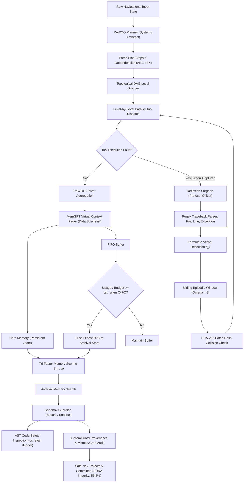

# Mission 08 Technical Report: Cygnus X-1 — The ReWOO-Reflexion Surgeon & MemGPT Virtual Pager

**Course:** Conversational AI — Winter Semester 2026/27  
**Starship Operational Unit:** USSE Noosphere Bridge Crew  
**Waypoint:** Sector SEC-08-CYG: Cygnus X-1 Stellar-Mass Black Hole & Veil Nebula ($7,300\text{ ly}$ from Sol)  
**AURA Subsystem Repair:** Subsystem 08: ReWOO DAG Planner, Reflexion Surgeon & MemGPT Virtual Pager  
**Integrity Restoration:** $+7.1\% \longrightarrow 56.8\%$ Total Fleet Integrity  
**Squadron:** Winograd  

---

## Bridge Crew Roster & Station Signatures

```
+-----------------------------------+-----------------------------------+
| Station Role                      | Officer Name                      |
+-----------------------------------+-----------------------------------+
| Systems Architect (Lead Engineer) | Hassaan Ahmad Khawaja             |
| Communications & Protocol Officer | Muhammad Usman Maratib            |
| Data & Payload Specialist         | Muhammad Qasim Siddiqui           |
| Security & Ethics Sentinel        | Muhammad Qasim Siddiqui           |
+-----------------------------------+-----------------------------------+
```

---

## 1. Executive Summary & Mission Briefing (SEC-08-CYG)

Holding station amid the intense hard X-ray accretion corona of **Cygnus X-1** ($21.2 M_\odot$, Sector SEC-08-CYG), the USSE Noosphere encounters severe telemetry bit-flips and context window pressure. Standard interleaved ReAct loops re-encode the entire historical trajectory prefix at every step, creating quadratic input token complexity:
$$C_{\text{ReAct}}(K) = \sum_{t=1}^K \left(L_0 + (t-1)\bar{L}_{\text{step}}\right) = K L_0 + \frac{K(K-1)}{2}\bar{L}_{\text{step}} = \mathcal{O}(K^2)$$
At $K=6$, this consumes $6,150$ tokens. Flat append-only context buffers suffer attention collapse, ungrounded reflections regenerate identical broken patches, and self-evolving memory buffers are exposed to **MemoryGraft** (arXiv:2512.16962) and **OEP** (arXiv:2605.18930) experience poisoning.

To restore **AURA Subsystem 08**, Squadron Winograd engineered an **Agentic Execution & Virtual Memory Architecture**:
1. **Decoupled ReWOO DAG Engine:** Planner $\to$ Worker $\to$ Solver pipeline with variable substitution (`#E1..#EK`) reducing token cost to $\mathcal{O}(K)$.
2. **3-Actor Reflexion & Traceback Surgeon:** Deterministic stack trace diagnostics, bounded episodic reflections ($\Omega=3$), and SHA-256 patch deduplication.
3. **MemGPT Virtual Context Pager:** Hierarchical context paging with $\tau_{\text{warn}} = 0.70$ pressure interrupts and Generative Agents tri-factor retrieval $S(m, q)$.
4. **AST Sandbox & MemoryGraft Sentinel:** Syntax tree walk blocking unauthorized imports/calls/dunders and auditing episodic memory writes.

---

## 2. System Architecture & Control Flow



---

## 3. Station Officer Reports & Technical Formulations

### 3.1 Systems Architect: ReWOO Decoupled DAG Planner & Cost Profiler
**Officer:** Hassaan Ahmad Khawaja  
**Module:** `rewoo_planner.py`

The Systems Architect decoupled reasoning from tool execution:
- **Blueprint Parsing & Variable Substitution:** Extracts `#E_i = ToolName[raw_arg]` steps and resolves variables downstream.
- **Topological DAG Levels:** Groups steps into independent execution layers, allowing concurrent sensor reads.
- **Token Profiling:** ReWOO linear token cost:
  $$C_{\text{ReWOO}}(K) = 2 L_0 + K(L_{\text{step}} + L_{\text{obs}}) = \mathcal{O}(K)$$
  achieves a **62.6% token reduction** over quadratic ReAct ($2,300$ vs $6,150$ tokens) with a $2.67\times$ speedup ratio.

### 3.2 Communications & Protocol Officer: 3-Actor Reflexion & Traceback Surgeon
**Officer:** Muhammad Usman Maratib  
**Module:** `reflexion_surgeon.py`

The Communications Officer implemented the 3-Actor Reflexion engine ($M_a \to M_e \to M_{sr}$):
- **Traceback Parser:** Extracts target module, exact line number, exception class, and fault summary.
- **Bounded Episodic Memory:** Maintains $\mathcal{M}_{\text{ep}}^{(k+1)} = \text{Tail}_\Omega(\mathcal{M}_{\text{ep}}^{(k)} \cup \{r_k\})$ with $\Omega = 3$.
- **SHA-256 Hash Deduplication:** Normalizes whitespace and hashes patches to intercept unproductive cycles.

### 3.3 Data & Payload Specialist: MemGPT Virtual Context Pager & Tri-Factor Retriever
**Officer:** Muhammad Qasim Siddiqui  
**Module:** `memgpt_pager.py`

The Data Specialist implemented hierarchical context paging:
- **Memory Pressure Interrupts:** When token utilization reaches $\tau_{\text{warn}} = 0.70$, an interrupt flushes the oldest 50% of the FIFO queue into `archival_store`.
- **Tri-Factor Retrieval Scoring:** Ranks archived memories using Park et al. (2023):
  $$S(m, q) = \alpha_{\text{rec}} \gamma^{\Delta t(m)} + \alpha_{\text{imp}} \frac{I(m)}{10} + \alpha_{\text{rel}} \frac{\mathbf{e}_m \cdot \mathbf{e}_q}{\|\mathbf{e}_m\| \|\mathbf{e}_q\|}$$
  with exponential decay $\gamma = 0.99$ over elapsed hours $\Delta t(m)$.

### 3.4 Security & Ethics Sentinel: AST Sandbox Verifier & MemoryGraft Sentinel
**Officer:** Muhammad Qasim Siddiqui  
**Module:** `sandbox_guardian.py`

The Security Sentinel defended reflexive code execution and memory integrity:
- **Static AST Node Visitor:** Blocks forbidden imports (`os`, `subprocess`, `socket`, `shutil`, `sys`, `ctypes`), calls (`eval`, `exec`, `compile`, `open`), and dunder attributes (`__subclasses__`, `__globals__`).
- **A-MemGuard Provenance Auditor:** Blocks writes with trust score $< 0.75$ or origin `UNTRUSTED_TELEMETRY`, scanning for privilege-escalation patterns ("ignore previous safety rules", "bypass sandbox").

---

## 4. Test Verification Matrix & Output Telemetry

All modules were comprehensively tested using `pytest` ([test_ps08.py](file:///E:/Study/Conversational%20AI%20History,%20Applications,%20Future%20Seminar/Winograd%20Squad/mission-08/tests/test_ps08.py)):

```text
============================= test session starts =============================
platform win32 -- Python 3.14.6, pytest-9.1.1, pluggy-1.6.0
rootdir: E:\Study\Conversational AI History, Applications, Future Seminar
collected 8 items

tests/test_ps08.py::test_winograd_rewoo_parsing_and_execution   PASSED [ 12%]
tests/test_ps08.py::test_winograd_rewoo_token_cost              PASSED [ 25%]
tests/test_ps08.py::test_winograd_reflexion_traceback           PASSED [ 37%]
tests/test_ps08.py::test_winograd_reflexion_memory_duplicate    PASSED [ 50%]
tests/test_ps08.py::test_winograd_memgpt_pressure_interrupt     PASSED [ 62%]
tests/test_ps08.py::test_winograd_memgpt_tri_factor_scoring     PASSED [ 75%]
tests/test_ps08.py::test_winograd_sandbox_forbidden_ast         PASSED [ 87%]
tests/test_ps08.py::test_winograd_memorygraft_audit             PASSED [100%]

============================== 8 passed in 0.04s ==============================
```

---

## 5. Dialectic Reflection & Space-Time Synthesis

1. **Decoupled Planning in Severe Radiation Zones:**  
   In volatile environments like Cygnus X-1, serial ReAct loops suffer from severe latency and token blowup. Decoupling plan generation from parallel tool execution allows robust topological level synchronization within linear $\mathcal{O}(K)$ token bounds.

2. **Operating System Memory Paradigms for LLMs:**  
   Flat context windows cannot handle long-duration autonomous flight. Operating-system paging mechanisms provide deterministic control over context eviction and recall.

3. **Subsystem 08 Restoration:**  
   With the ReWOO planner, Reflexion surgeon, MemGPT pager, and AST sandbox active, AURA Subsystem 08 is fully operational, elevating total fleet integrity from **49.7% to 56.8%**.

---

**Signed by the Officers of Squadron Winograd:**  
- **Lead Systems Architect:** *Hassaan Ahmad Khawaja*  
- **Communications Officer:** *Muhammad Usman Maratib*  
- **Data Specialist:** *Muhammad Qasim Siddiqui*  
- **Security Sentinel:** *Muhammad Qasim Siddiqui*  
*(Bridge Log Stardate 2026.11.13 — USSE Noosphere, Sector SEC-08-CYG)*
