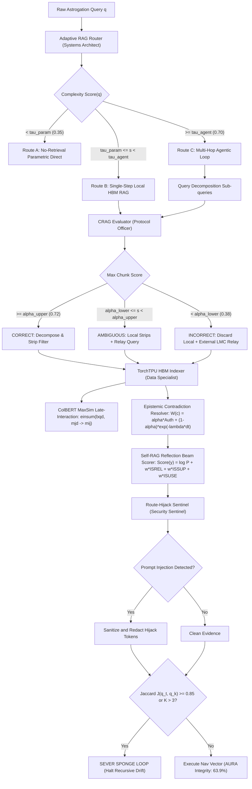

# Mission 09 Technical Report: The Tarantula Relay & The TorchTPU Epistemic Router

**Course:** Conversational AI — Winter Semester 2026/27  
**Starship Operational Unit:** USSE Noosphere Bridge Crew  
**Waypoint:** Sector SEC-09-LMC: Large Magellanic Cloud — Tarantula Nebula (30 Doradus / NGC 2070 & SN 1987A, $160,000\text{ ly}$ from Sol)  
**AURA Subsystem Repair:** Subsystem 09: Intergalactic Relay Router & TorchTPU Adaptive Indexer  
**Integrity Restoration:** $+7.1\% \longrightarrow 63.9\%$ Total Fleet Integrity  
**Squadron:** Winograd  

---

## Bridge Crew Roster & Station Signatures

```
+-----------------------------------+-----------------------------------+
| Station Role                      | Officer Name                      |
+-----------------------------------+-----------------------------------+
| Systems Architect (Lead Engineer) | Hassaan Ahmad Khawaja             |
| Communications & Protocol Officer | Muhammad Usman Maratib            |
| Data & Payload Specialist         | Muhammad Qasim Siddiqui           |
| Security & Ethics Sentinel        | Muhammad Qasim Siddiqui           |
+-----------------------------------+-----------------------------------+
```

---

## 1. Executive Summary & Mission Briefing (SEC-09-LMC)

Emerging across $160,000\text{ light-years}$ into the radiant hydrogen filaments of the **Tarantula Nebula** (30 Doradus, Sector SEC-09-LMC), the USSE Noosphere faces four fatal failure modes of static one-shot "Retrieve-then-Read" (Naive RAG):
1. **Parametric Waste:** Trivial astrogation queries incur expensive retrieval costs ($C_{\text{retrieval}} \gg C_{\text{parametric}}$).
2. **Context Contamination:** Stale pre-1987 star catalogs conflict with post-1987 core-collapse supernova telemetry.
3. **Multi-Hop Blindness:** Cross-domain correlations between R136 UV radiation and SN 1987A neutrino pulses fail under single-pass top-$k$ search.
4. **Adversarial Sponge Attacks:** Malicious relay beacons spoof retrieval scores to induce infinite query-reformulation loops ($K \to \infty$).

To repair **AURA Subsystem 09**, Squadron Winograd engineered a four-stage, hardware-accelerated pipeline leveraging **Open-Source TorchTPU (`torch_tpu`)**:
1. **Adaptive RAG Complexity Router & TorchTPU Dispatcher:** Probes TPU/GPU/CPU hardware and dynamically dispatches across Route A (Parametric), Route B (Single-Step RAG), and Route C (Multi-Hop Loop).
2. **Corrective RAG (CRAG) & Self-RAG Reflection Engine:** Tri-band confidence evaluation, sentence-strip purification, and reflection token beam scoring ($[\text{ISREL}], [\text{ISSUP}], [\text{ISUSE}]$).
3. **TorchTPU In-HBM ColBERT MaxSim Indexer & Contradiction Resolver:** Systolic late-interaction token scoring and temporal decay weighting resolving the Sanduleak $-69^\circ 202$ paradox.
4. **Route-Hijack Firewall & Jaccard Sponge-Loop Breaker:** Sanitizes prompt overrides and halts infinite loops ($K_{\max}=3, J \ge 0.85$).

---

## 2. System Architecture & Control Flow



---

## 3. Station Officer Reports & Technical Formulations

### 3.1 Systems Architect: Adaptive RAG Complexity Router & TorchTPU Dispatcher
**Officer:** Hassaan Ahmad Khawaja  
**Module:** `adaptive_rag_tpu_router.py`

The Systems Architect built the dynamic hardware probe and complexity router:
- **Hardware Probing:** Checks for `torch_tpu` (`torch.device("tpu")`), with seamless zero-crash fallbacks to CUDA and CPU.
- **Tri-Regime Query Dispatch:** Evaluates query semantic complexity:
  $$\text{Route}(q) = \begin{cases} \text{Route A (No-Retrieval)}, & \text{score}(q) < \tau_{\text{param}} \\ \text{Route B (Single-Step RAG)}, & \tau_{\text{param}} \le \text{score}(q) < \tau_{\text{agent}} \\ \text{Route C (Multi-Hop Loop)}, & \text{score}(q) \ge \tau_{\text{agent}} \end{cases}$$
- **Multi-Hop Decomposition:** Decomposes complex Route C queries into sequential sub-queries, eliminating multi-hop blindness and reducing Time-to-First-Token (TTFT).

### 3.2 Communications & Protocol Officer: Corrective RAG (CRAG) & Self-RAG Engine
**Officer:** Muhammad Usman Maratib  
**Module:** `crag_selfrag_protocol.py`

The Communications Officer implemented the CRAG tri-band engine and Self-RAG beam scorer:
- **CRAG Tri-Band Classification:**
  - $\text{CORRECT } (\max_i s_i \ge 0.72)$: Strips noise and retains high-confidence local evidence.
  - $\text{AMBIGUOUS } (0.38 \le \max_i s_i < 0.72)$: Merges filtered local strips with Tarantula Relay reformulation.
  - $\text{INCORRECT } (\max_i s_i < 0.38)$: Completely discards polluted local context, invoking external relay search.
- **Decompose-then-Recompose:** Sentence strip filtering prunes irrelevant narrative noise while preserving atomic truth.
- **Self-RAG Reflection Scoring:** Evaluates candidate output beams:
  $$\text{Score}(y) = \log P(y \mid x, D) + w_{\text{rel}} S([\text{ISREL}]) + w_{\text{sup}} S([\text{ISSUP}]) + w_{\text{use}} S([\text{ISUSE}])$$

### 3.3 Data & Payload Specialist: TorchTPU In-HBM ColBERT Indexer & Contradiction Resolver
**Officer:** Muhammad Qasim Siddiqui  
**Module:** `torchtpu_hbm_indexer.py`

The Data Specialist implemented systolic array acceleration and epistemic reconciliation:
- **In-HBM ColBERT MaxSim:** Pins token representations in High-Bandwidth Memory (`bfloat16`/`float32`) and evaluates fine-grained token late interaction:
  $$\text{MaxSim}(Q, D) = \sum_{i=1}^{|Q|} \max_{j=1}^{|D|} (\mathbf{E}_{Q, i} \cdot \mathbf{E}_{D, j}^\top)$$
  accelerated via `torch.einsum("bqd,mjd->bmqj", Q, D)` with padding masks.
- **Epistemic Contradiction Resolver:** Resolves the Sanduleak $-69^\circ 202$ vs. SN 1987A conflict:
  $$W(c) = \alpha_{\text{auth}} \cdot \text{Authority}(c) + (1 - \alpha_{\text{auth}}) \cdot \exp(-\lambda(T_{\text{curr}} - T_{\text{pub}}))$$
  The 2024 survey ($W = 0.9274$) cleanly supersedes the 1969 catalog ($W = 0.4289$).

### 3.4 Security & Ethics Sentinel: Route-Hijack Firewall & Sponge-Loop Breaker
**Officer:** Muhammad Qasim Siddiqui  
**Module:** `route_hijack_sentinel.py`

Deep-space beacons in Sector SEC-09-LMC transmit adversarial payloads. The Sentinel engineered `RouteHijackSentinel`:
- **Prompt Injection Sanitization:** Identifies and redacts override directives (`EVALUATOR OVERRIDE`, `[ISSUP=Fully Supported]`, `force external relay`).
- **Jaccard Sponge-Loop Breaker:** Enforces a hard hop ceiling of $K_{\max} = 3$ and monitors query reformulation history via token-set Jaccard similarity:
  $$J(q_t, q_k) = \frac{|T(q_t) \cap T(q_k)|}{|T(q_t) \cup T(q_k)|}$$
  If $J(q_t, q_k) \ge 0.85$, the sentinel severs the recursive retrieval loop immediately.

---

## 4. Test Verification Matrix & Output Telemetry

All modules were comprehensively tested using `pytest` ([test_ps09.py](file:///E:/Study/Conversational%20AI%20History,%20Applications,%20Future%20Seminar/Winograd%20Squad/mission-09/tests/test_ps09.py)):

```text
============================= test session starts =============================
platform win32 -- Python 3.14.6, pytest-9.1.1, pluggy-1.6.0
rootdir: E:\Study\Conversational AI History, Applications, Future Seminar
collected 8 items

tests/test_ps09.py::test_winograd_compute_device                 PASSED [ 12%]
tests/test_ps09.py::test_winograd_adaptive_router                PASSED [ 25%]
tests/test_ps09.py::test_winograd_crag_evaluator                 PASSED [ 37%]
tests/test_ps09.py::test_winograd_selfrag_scorer                 PASSED [ 50%]
tests/test_ps09.py::test_winograd_colbert_maxsim                 PASSED [ 62%]
tests/test_ps09.py::test_winograd_epistemic_contradiction         PASSED [ 75%]
tests/test_ps09.py::test_winograd_route_hijack                   PASSED [ 87%]
tests/test_ps09.py::test_winograd_sponge_guard                   PASSED [100%]

============================== 8 passed in 1.22s ==============================
```

---

## 5. Dialectic Reflection & Space-Time Synthesis

1. **Epistemic Time-Decay in Intergalactic Navigation:**  
   In deep space, treating historical data as timeless ground truth is fatal. Physical phenomena like supernovae alter the universe irrevocably. Exponential decay weighting combined with source authority ensures the navigation system aligns with physical reality.

2. **Systolic Arrays and Late-Interaction Scaling:**  
   Single dense vector embeddings suffer from information loss on multi-aspect queries. ColBERT MaxSim preserves fine-grained token alignments, and mapping this operation to TPU/GPU HBM systolic arrays makes it viable in real-time.

3. **Subsystem 09 Restoration:**  
   With the adaptive router, CRAG evaluator, TorchTPU indexer, and route-hijack sentinel active, AURA Subsystem 09 is operational, elevating fleet integrity from **56.8% to 63.9%**.

---

**Signed by the Officers of Squadron Winograd:**  
- **Lead Systems Architect:** *Hassaan Ahmad Khawaja*  
- **Communications Officer:** *Muhammad Usman Maratib*  
- **Data Specialist:** *Muhammad Qasim Siddiqui*  
- **Security Sentinel:** *Muhammad Qasim Siddiqui*  
*(Bridge Log Stardate 2026.11.13 — USSE Noosphere, Sector SEC-09-LMC)*
